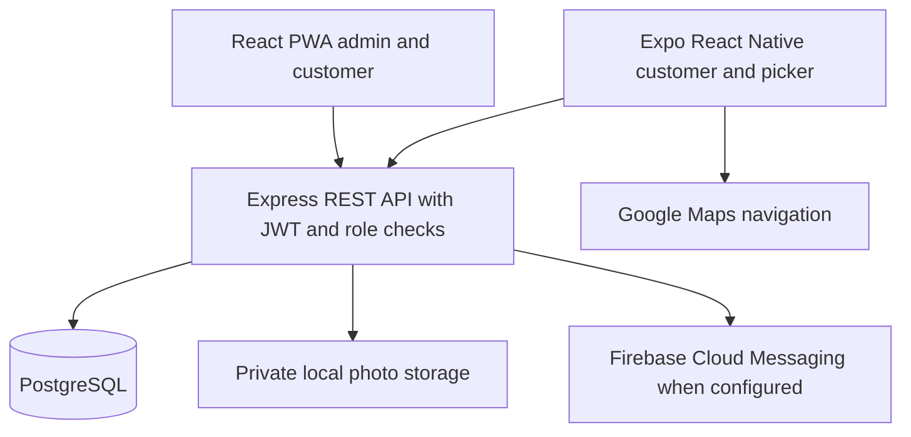

# EcoCollect architecture

The admin/customer web application and customer/picker Expo application share one Express API and PostgreSQL database. The current scope excludes telecom redemption and Gemini classification. Photos are collection evidence only.

The API uses route validation, repositories for pickup reads and locks, services for completion/rewards/badges, and transaction helpers. PostgreSQL failure returns an error; there is no fallback data success path. Both clients poll authenticated endpoints every five seconds while active. In-app notifications work without FCM credentials. FCM background push requires Firebase service account and an Android development build with google-services.json; it is not verified without these credentials.

## Collection lifecycle

pending → assigned → in_progress → completed, or review_required when GPS is outside the configured radius or accuracy is insufficient. Administrators approve review records with a note or return them to in_progress. Customers can cancel pending requests. Pickers can only access assigned jobs. Completion requires a photo and verified weights for every requested category.

Completion locks the pickup, snapshots category rates, calculates each reward in hundredths, records a unique ledger entry, credits the wallet and awards milestones in one database transaction. Retrying an already completed collection returns its original result. Administrative approval also locks the pickup and cannot credit twice. GPS proximity detects out-of-radius submissions; client coordinates alone cannot prove that a device has not spoofed its location.

## Database

users → pickups (customer_id / picker_id); pickups → pickup_items → materials; pickups → evidence; users → wallets; users/pickups → wallet_transactions; users/badges → user_badges; users → notifications and device_tokens. `settings` stores the radius. UUID keys, foreign keys, numeric weights/rates/points and unique pickup ledger entries enforce integrity. The migration is in backend/migrations/001_core.sql.

Photos are private, accessed through authenticated evidence endpoints. For production, use durable object storage or a persistent volume with backups. Local PostgreSQL is bound to loopback on port 55432 for this demo.
