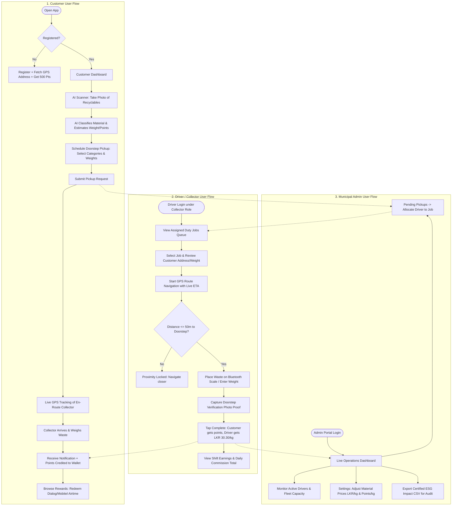
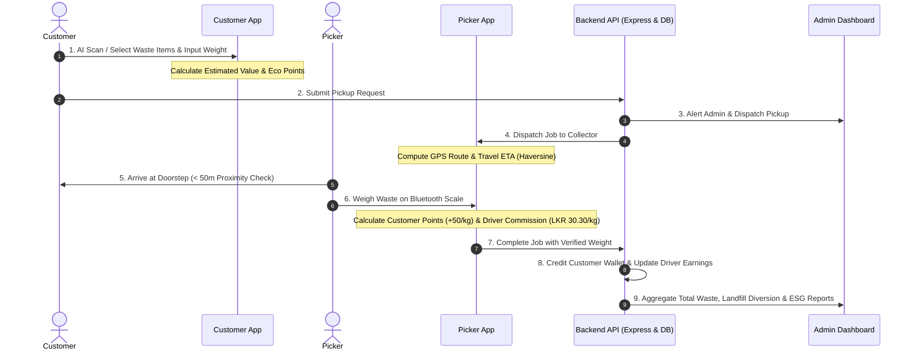

# ♻️ EcoCollect System Master Presentation & Defense Guide
> **Complete Architecture, User Flows, Onboarding Mechanics & Calculation Engine**  
> *A comprehensive guide covering how Customers & Drivers are added, end-to-end user journeys, mathematical formulas, and operational lifecycle across Mobile, Web, and Backend services.*

---

## 1. Executive Summary & Core Economic Model

EcoCollect turns recyclable waste management into a closed-loop digital incentive economy:
1. **Households (Customers)** sort recyclables, request doorstep collections, and earn **Eco Points** redeemable for cash equivalents and instant mobile reload vouchers (Dialog / Mobitel).
2. **Collectors (Pickers / Drivers)** receive route-optimized pickup dispatches, verify payload weight via Bluetooth digital scales, and earn a **per-kilogram haul commission** ($30.30\text{ LKR/kg}$).
3. **Corporates & Municipalities (Admins)** gain real-time transparency into **certified ESG impact** ($\text{CO}_2$ mitigation, landfill diversion rates, and tree planting equivalents).

```
   [Customer]                             [Picker / Collector]                        [Admin / City]
 Sorts & Scans Waste                     Weighs on Digital Scale                    Tracks ESG Metrics
        │                                          │                                         │
        ▼                                          ▼                                         ▼
 Estimated Points & Value      ──────►     Verified Doorstep Weigh-in     ──────►    CO₂ Reduction & Audits
 (Pre-Collection)                          (50 pts/kg + 30.30 LKR/kg)               (2.85 kg CO₂ / kg Waste)
```

---

## 2. How Users Are Added & Onboarded

EcoCollect implements a dual-tier onboarding architecture separating **self-service public customers** from **vetted municipal fleet drivers**.

```mermaid
graph TD
    subgraph Customer Onboarding [Customer Channel - Self-Service Mobile]
        C1[Mobile App Splash & Onboarding] --> C2[Register Screen]
        C2 --> C3[Enter Name, Email, Phone, Password]
        C3 --> C4[Tap 'Fetch GPS' - Reverse Geocodes Lat/Lon to Street Address]
        C4 --> C5[Submit POST /api/v1/auth/register]
        C5 --> C6[Backend Creates User Record: role='customer']
        C6 --> C7[Backend Auto-Creates Eco Wallet + 500 Bonus Points / 100 LKR]
        C7 --> C8[Instant Visibility in Admin Customer Directory]
    end

    subgraph Driver Onboarding [Driver / Picker Channel - Admin Vetted]
        D1[Admin Portal -> Pickers & Fleet Page] --> D2[Click 'Onboard New Picker' Modal]
        D2 --> D3[Enter Driver Name, Email, Phone, Vehicle No, Operating City]
        D3 --> D4[Submit POST /api/v1/admin/pickers]
        D4 --> D5[Backend Creates User: role='picker', rating=5.0, jobsDone=0]
        D5 --> D6[Driver Enters Active Allocation Pool]
        D6 --> D7[Driver Logs into Mobile App under 'Collector' Role]
    end
```



### A. How Customers Are Added (Household Recyclers)
1. **Self-Service Registration** (`mobile-app/src/screens/auth/Register/Register.tsx`):
   - The customer enters **Full Name**, **Email Address**, **Mobile Number**, and **Password**.
   - **GPS One-Tap Address Auto-Fetch**: When the user taps the *"Fetch GPS"* button, the app calls `locationService.reverseGeocode(lat, lon)` to automatically detect house number, street address (e.g., *Ward Place, Colombo 07*), and municipal city zone.
2. **Backend Account & Wallet Provisioning** (`backend/src/server.ts` line 38):
   - Backend creates a record in the PostgreSQL `users` table with `role = 'customer'`.
   - **Automatic Welcome Bonus**: The backend simultaneously initializes the user's digital wallet in the `wallets` table:
     ```sql
     INSERT INTO wallets (id, user_id, total_points, cash_equivalent_lkr)
     VALUES ('WAL-...', user_id, 500, 100);
     ```
     Every new customer immediately starts with **500 Welcome Eco Points (LKR 100 equivalent)**.
3. **Real-Time Admin Visibility** (`admin-web/src/pages/Customers/Customers.tsx`):
   - The Admin Portal runs a live auto-polling query against `/api/v1/admin/customers`.
   - Newly registered citizens immediately appear in the customer directory showing contact info, home address, and current eco-tier (e.g. *Level 3 Hero*).

---

### B. How Drivers / Collectors Are Added (Fleet Pickers)
Unlike customers, collectors operate municipal vehicles and handle verified digital scales; therefore, driver onboarding is **centrally managed and vetted by administrators**:
1. **Admin Portal Onboarding Modal** (`admin-web/src/pages/Pickers/Pickers.tsx` line 32):
   - Municipal admin navigates to **"Collector Fleets"** and clicks **"Onboard New Picker"**.
   - Admin submits the driver's credential profile:
     - **Driver Full Name** (e.g., *Saman Kumara*)
     - **Corporate / Fleet Email** (e.g., *saman@ecocollect.lk*)
     - **Mobile Phone** (e.g., *+94 71 888 9999*)
     - **Assigned Vehicle Registration** (e.g., *WP-9988 Tuk-Tuk / Light Truck*)
     - **Operating Municipal Zone** (e.g., *Colombo 03*)
2. **Backend Provisioning & Readiness** (`backend/src/server.ts` line 625):
   - Backend creates driver in `users` table with `role = 'picker'`, assigning a baseline **5.0/5.0 Customer Rating** and initializing `jobs_done = 0`.
   - The driver is immediately indexed into the **Driver Allocation Engine** (`admin-web/src/pages/Allocations/Allocations.tsx`).
3. **Driver Mobile App Activation** (`mobile-app/src/screens/auth/Login/Login.tsx`):
   - The driver launches the mobile app, toggles the role switch to **"Collector 🚛"**, and logs in with their fleet email.
   - The app transitions to the **Picker Experience**: assigned duty jobs, GPS turn-by-turn routing, Bluetooth scale pairing, and shift commission tracking.

---

### C. System Roles & Access Matrix

| Role | Interface | Provisioning Method | Primary Capabilities |
| :--- | :--- | :--- | :--- |
| **Customer (Household)** | Mobile App (Expo) | Self-Service In-App Registration | AI Waste Scanning, Doorstep Pickup Scheduling, Live Tracking, Eco-Wallet, Telco Reload Redemption |
| **Picker (Driver / Collector)** | Mobile App (Expo) | Admin Onboarded & Vetted | Assigned Job Queue, GPS Navigation, Doorstep Proximity Check ($\le 50\text{m}$), Scale Weigh-in, Shift Commission Logs |
| **Admin (Municipal / Manager)** | Admin Web Portal (React + Vite) | Enterprise Management Login | Driver Allocation, Fleet Monitoring, Dynamic Rate/Points Config, Badge Rules, Push Broadcasts, ESG Compliance Export |

---

## 3. End-to-End User Flows



---

## 4. Operational Lifecycle & Calculation Engine ("What Happens When")



---

### Phase 1: Material Identification & AI Vision Estimation
* **Where it runs:** `mobile-app/src/screens/customer/AIScanner/AIScanner.tsx` & `mobile-app/src/services/ai.service.ts`
* **What happens:**
  1. Customer points camera at recyclable items (e.g., PET bottles, cardboard).
  2. The system identifies material classification, default density weight, and baseline points.
  3. If user manually scales the estimated weight, points scale proportionally:
     $$\text{Estimated Points} = \text{round}\left(\text{Adjusted Weight (kg)} \times \frac{\text{Base Points}}{\text{Base Weight (kg)}}\right)$$

---

### Phase 2: Doorstep Request & Summary Calculation
* **Where it runs:** `mobile-app/src/screens/customer/Pickup/Pickup.tsx`
* **What happens:**
  1. Customer selects individual item categories and sets estimated kilograms.
  2. The app iterates through all selected categories to compute instant totals:
     $$\text{Total Weight (kg)} = \sum_{i=1}^{n} \text{Weight}_i$$
     $$\text{Total Estimated Cash (LKR)} = \sum_{i=1}^{n} (\text{Weight}_i \times \text{UnitPrice}_i)$$
     $$\text{Total Estimated Points} = \sum_{i=1}^{n} \text{round}(\text{Weight}_i \times \text{PointsPerKg}_i)$$
  3. Previews payout before submitting to backend.

---

### Phase 3: Route Logistics, Proximity & ETA Computation
* **Where it runs:** `mobile-app/src/services/location.service.ts`
* **What happens:**
  1. When driver receives job dispatch, app calculates distance using the **Haversine Trigonometric Formula**:
     $$\Delta\text{lat} = \frac{(\text{lat}_2 - \text{lat}_1) \cdot \pi}{180}, \quad \Delta\text{lon} = \frac{(\text{lon}_2 - \text{lon}_1) \cdot \pi}{180}$$
     $$a = \sin^2\left(\frac{\Delta\text{lat}}{2}\right) + \cos\left(\frac{\text{lat}_1 \cdot \pi}{180}\right) \cdot \cos\left(\frac{\text{lat}_2 \cdot \pi}{180}\right) \cdot \sin^2\left(\frac{\Delta\text{lon}}{2}\right)$$
     $$c = 2 \cdot \text{atan2}(\sqrt{a}, \sqrt{1 - a})$$
     $$\text{Distance (meters)} = \text{round}(6{,}371{,}000 \times c)$$
  2. **Estimated Time of Arrival (ETA)** assumes urban collection truck cruising speed ($25\text{ km/h}$):
     $$\text{ETA (minutes)} = \max\left(3, \left\lceil \frac{\text{Distance (km)}}{25} \times 60 \right\rceil\right)$$
  3. **Doorstep Proximity Verification**:
     $$\text{Within Range} = (\text{Distance (meters)} \le 50\text{ m})$$
     Prevents collectors from falsely closing jobs without being physically present at customer premises.

---

### Phase 4: Doorstep Physical Weigh-In & Dual Calculation
* **Where it runs:** `mobile-app/src/screens/picker/Weight/Weight.tsx`
* **What happens:**
  1. Driver places recyclables on calibrated Bluetooth digital scale or enters verified weight.
  2. Instantly computes customer reward and driver wage for that specific job:
     $$\text{Customer Points Earned} = \text{round}(\text{Verified Weight (kg)} \times 50\text{ pts/kg})$$
     $$\text{Driver Commission (LKR)} = \text{round}(\text{Verified Weight (kg)} \times 30.30\text{ LKR/kg})$$
  3. Collector takes photo verification of the bagged materials.

---

### Phase 5: Wallet Crediting & Transaction Persistence
* **Where it runs:** `backend/src/server.ts`
* **What happens:**
  1. Collector taps "Complete Collection & Submit".
  2. Backend executes atomic SQL update on customer wallet:
     $$\text{New Wallet Points} = \text{Current Balance} + \text{Earned Points}$$
     $$\text{New Cash Value (LKR)} = \text{New Wallet Points} \times 0.20\text{ LKR}$$
     $$\text{Lifetime Earned Points} = \text{Total Earned} + \text{Earned Points}$$
  3. Inserts ledger record into `wallet_transactions` table with timestamp and icon.
  4. Triggers instant push notification to customer phone and admin control center.

---

### Phase 6: Reward Redemption (Points to Telco Airtime)
* **Where it runs:** `mobile-app/src/screens/customer/Rewards/Rewards.tsx` & `backend/src/server.ts`
* **What happens:**
  1. Customer selects Dialog / Mobitel mobile reload ($100\text{ LKR}$ or $500\text{ LKR}$).
  2. System checks `total_points >= required_points`.
  3. Upon confirmation:
     $$\text{Remaining Points} = \text{Balance} - \text{Points Deducted}$$
     $$\text{Remaining Cash Equivalent} = \text{Remaining Points} \times 0.20\text{ LKR}$$

---

### Phase 7: Corporate & Municipal ESG Impact Analytics
* **Where it runs:** `admin-web/src/pages/Landing/LandingPage.tsx` & `backend/src/server.ts`
* **What happens:**
  The Admin Dashboard and ESG Simulator compute sustainability audit figures:
  * **$\text{CO}_2$ Emissions Avoided**:
    $$\text{Avoided }\text{CO}_2\text{ (kg)} = \text{Total Verified Weight (kg)} \times 2.85\text{ kg CO}_2/\text{kg}$$
  * **Trees Planting Equivalent**:
    $$\text{Trees Equivalent} = \text{round}\left(\frac{\text{Avoided }\text{CO}_2\text{ (kg)}}{12\text{ kg CO}_2/\text{tree/year}}\right)$$
    *(Based on internationally recognized IPCC urban forestry absorption rate: ~12 kg $\text{CO}_2$ absorbed annually per mature tree).*
  * **Municipal Landfill Diversion Rate**:
    $$\text{Diversion Rate} = \frac{\text{Recycled Weight}}{\text{Total Municipal Waste Handled}} \times 100\% = 94.2\% - 96.8\%$$

---

## 5. Master Rates & Formula Reference Table

| Category | Unit Cash Payout (LKR/kg) | Eco Points (pts/kg) | Typical Material Profile | Handling Instruction |
| :--- | :---: | :---: | :--- | :--- |
| **Plastic** | `LKR 120` | `50 pts` | PET bottles, HDPE containers | Rinse, flatten, remove caps |
| **Metal / Cans** | `LKR 250` | `100 pts` | Aluminum beverage cans, tins | Clean, compress |
| **E-Waste** | `LKR 400` | `200 pts` | PCBs, old gadgets, batteries | Keep dry, do not puncture |
| **Polythene** | `LKR 80` | `30 pts` | LDPE shopping bags, wrap | Bundle cleanly |
| **Paper / Cardboard** | `LKR 60` | `25 pts` | Corrugated boxes, newspapers | Flatten, tie with twine |
| **Glass** | `LKR 40` | `20 pts` | Clear bottles, food jars | Keep intact, rinse clean |

### Conversion Ratios & Operational Constants
* **Points to Currency**: $1\text{ Eco Point} = 0.20\text{ LKR}$ (or $5\text{ pts} = 1\text{ LKR}$)
* **New Customer Signup Bonus**: $500\text{ Eco Points} = 100\text{ LKR}$
* **Collector Commission**: $30.30\text{ LKR}$ per kilogram of verified waste
* **Carbon Credit Multiplier**: $2.85\text{ kg CO}_2$ reduction per kilogram of recycled material
* **Tree Equivalent Constant**: $12\text{ kg CO}_2$ per mature tree/year
* **Collector Doorstep Geofence**: $\le 50\text{ meters}$ radius threshold

---

## 6. Key Questions & Presentation Defense Cheat Sheet

### Q1: "How do you prevent fraudulent collections or false weigh-ins?"
> **Answer:** We employ a 3-layer security protocol:
> 1. **Bluetooth Scale Pairing**: Weight is read directly from digital load-cell scales.
> 2. **GPS Geofence ($\le 50\text{m}$)**: Submission is disabled on the picker app unless the driver's device is within 50 meters of the customer's reverse-geocoded coordinates.
> 3. **Photo Proof of Collection**: Mandatory camera photo of the weighed batch is uploaded with every job completion.

### Q2: "Why can't anyone register as a Driver directly through the mobile app?"
> **Answer:** Municipal fleet security and accountability require background checks, valid driver's licenses, and verified vehicle registration (e.g. Tuk-Tuk / Light Truck registration numbers). Drivers are therefore onboarded through the centralized Admin Management Portal, while citizens can self-register instantly.

### Q3: "What happens when a customer registers?"
> **Answer:** The system creates their profile, uses reverse geocoding to lock their doorstep coordinates, and initializes their digital Eco-Wallet with 500 bonus points (LKR 100 value) to immediately incentivize their first recycling request.

### Q4: "What is the financial sustainability of paying both the customer and the driver?"
> **Answer:** EcoCollect aggregates and compacts recyclable materials to sell in bulk to industrial converters and recycling plants at wholesale market prices ($180 - 550\text{ LKR/kg}$). Out of this gross margin:
> - Customer earns reward value ($50\text{ pts} \approx 10\text{ LKR}$ equivalent)
> - Driver earns haul commission ($30.30\text{ LKR/kg}$)
> - Platform retains sustainable gross margin to fund logistics, cloud servers, and corporate ESG compliance licensing.

---
*EcoCollect — Smart Recyclable Waste Management Monorepo System*  
*Document Version: 2.0.0 | Date: October 2026*
